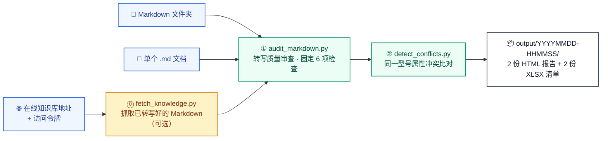

<div align="center">

# 🧭 knowledge-audit-skill

**知识库质量审查 Agent Skill**

一条命令查出两类问题：**文档转写得好不好**、**同一型号的参数是否互相矛盾** ——
每条结论都带证据定位（文件 / 行号 / 原文），并交付 **2 份 HTML 报告 + 2 份 XLSX 清单表格**。

[](https://agentskills.io)
[](https://docs.claude.com/en/docs/claude-code/skills)
[](https://developers.openai.com/codex/)
[](https://www.python.org/)
[](#快速开始)
[](LICENSE)

`Agent Skills` · `Claude Code` · `Codex` · `知识库审计` · `转写质量` · `参数一致性` · `HTML 报告` · `XLSX 清单`

</div>

---

## 它解决什么问题

| 症状 | 本技能的答案 |
| --- | --- |
| 文档转写成 Markdown 后“有些地方看着就不对”：乱码、替换字符、`[OCR]`、`待补充`、空文件…… | **① 转写质量审查**：固定 6 项检查逐行检出，给出文件、行号与证据原文 |
| 两份手册写了同一台机器（如 `机器ABCDEF-100`）的“操作重量”，一份 12300 kg、一份 12400 kg | **② 同一型号属性冲突检测**：按「型号 + 属性名 + 工况」精确分组比对，列出全部来源文件与取值 |

- **不猜、不编**：每条结论都附文件、行号、证据原文；
- **只报问题、不设分级**：性质判断交给人；
- **只读**：不修改任何输入文档，报告只写进 `output/<时间戳>/`；
- **零依赖**：只需 Python 3.9+ 与标准库，不装 openpyxl / pandas 也能生成带样式的 XLSX。

## 工作流程



## 交付物

每次运行在 `output/<YYYYMMDD-HHMMSS>/` 固定交付 4 个文件（一次任务一个目录，互不覆盖）：

| 交付文件 | 内容 | 用途 |
| --- | --- | --- |
| `知识库文档解析与转写质量问题报告.html` | 审查概况、问题分布（按 6 项检查逐项列数量与占比）、按文件分组的问题明细（行号 + 证据原文） | 人读：一眼看出**哪个文档的什么地方有什么问题** |
| `知识库文档解析与转写质量问题报告.xlsx` | 逐行清单：文件、行号、问题类型、问题说明、证据原文、建议操作 | 筛选/统计：Excel / WPS 双击即开 |
| `知识库同类属性冲突审查报告.html` | 比对概况 + 每个冲突分组的各来源文档、行号、原始取值、换算后取值与证据 | 人读：一眼看出**哪几个文档的什么属性不一致** |
| `知识库同类属性冲突审查报告.xlsx` | 逐行清单：冲突编号、型号、属性、工况、原始取值、换算后取值、文档、行号、证据原文 | 按「冲突编号」筛出同一处冲突涉及哪几个文档 |

> HTML 单文件自包含（样式内联，双击即开、可直接转发）；XLSX 表头着色、列宽加宽、单元格边框、隔行斑马纹、首行冻结并开启自动筛选。

## 快速开始

环境要求：**Python 3.9+**，只用标准库，**不需要** `pip install`；输入只需已经转写好的 Markdown 文本，**不需要**原始 DOCX / PDF / 图片。

```bash
# 1) 获取代码
git clone https://github.com/<your-name>/knowledge-audit-skill.git
cd knowledge-audit-skill

# 2) 一条命令跑完整流程（input/ 已内置演示数据）
python scripts/run_all.py input/

# 3) 打开交付文件
#    output/<时间戳>/知识库文档解析与转写质量问题报告.html
#    output/<时间戳>/知识库同类属性冲突审查报告.html
```

常用变体：

```bash
# CI 卡口：发现问题即退出码 3
python scripts/run_all.py input/ --fail-on-issue

# 直接给在线知识库地址：先抓取再审查（令牌也可用环境变量 KB_ACCESS_TOKEN）
python scripts/run_all.py --url "https://kb.example.com/knowledge/asset" --token "<token>"

# 接口挂在别的前缀下：用 --api-base 指定接口根地址
python scripts/run_all.py --url "https://kb.example.com/knowledge/asset" --token "<token>" \
  --api-base "https://kb.example.com/api/v1"

# 全量抓取列表内全部资产（不做任何过滤），再审查
python scripts/run_all.py --url "<知识库地址>" --token "<token>" --limit 0 --all-assets

# 只跑一个阶段
python scripts/audit_markdown.py input/     # ① 转写质量审查
python scripts/detect_conflicts.py input/   # ② 属性冲突比对
```

**输入三选一**：本地 Markdown 文件夹（递归扫描 `.md` / `.markdown`，支持中文路径与文件名）、单个 `.md` 文档、或在线知识库文档列表页地址（`--url` + `--token`，可加 `--api-base` / `--token-header`）。

**内置演示语料**：`input/` 里的机型与参数全部为虚构值 —— `example.md` 覆盖各类转写缺陷；`products/` 下两份 `机器ABCDEF-100` 文档故意留了一处冲突（操作重量 12300 kg vs 12400 kg）。完整预期结果（4 个交付文件、3 处质量问题、42 条属性记录、17 组比对、1 处冲突）见 [`input/README.md`](input/README.md)。

## 安装到 Agent

本技能遵循 [Agent Skills 开放标准](https://agentskills.io/specification)：一个技能就是一个目录，至少包含一个 `SKILL.md`。

**Claude Code**（项目级路径 `.claude/skills/knowledge-audit/`，仓库已内置）：

```bash
git clone https://github.com/<your-name>/knowledge-audit-skill.git && cd knowledge-audit-skill && claude
# 装到别的项目 / 个人级：
cp -r .claude/skills/knowledge-audit /path/to/your-project/.claude/skills/
cp -r .claude/skills/knowledge-audit ~/.claude/skills/
```

**Codex**（项目级路径 `.agents/skills/knowledge-audit/`，仓库已内置）：

```bash
cp -r .agents/skills/knowledge-audit /path/to/your-project/.agents/skills/
```

**其他客户端**：把 `knowledge-audit/` 目录（`SKILL.md` + `scripts/` + `rules/`）放进客户端扫描的 skills 目录即可，例如 `<client>/skills/knowledge-audit/`；可选校验格式：

```bash
npx skills-ref validate ./knowledge-audit-skill
```

使用方式：自然语言触发（“帮我审查这批知识库文档的转写质量”“比对这堆手册的参数是否互相矛盾”），或在支持技能命令的客户端里显式调用 `/knowledge-audit input/`。

> **维护提示**：根目录 `SKILL.md` 是唯一真源，`.claude/` 与 `.agents/` 下的副本由脚本同步 —— 改完执行 `python scripts/sync_skill.py`，校验用 `python scripts/sync_skill.py --check`（不一致时退出码 1）。

## 命令行参考

### `run_all.py`（推荐入口）

| 参数 | 默认值 | 说明 |
| --- | --- | --- |
| `input` | — | 待审查的 Markdown 文件或目录（与 `--url` 二选一） |
| `--url` | — | 在线知识库列表页地址；给出后先抓取 Markdown 再审查 |
| `--api-base` | `<站点>/api/v1` | 在线抓取的接口根地址（接口挂在别的前缀下时指定） |
| `--token` | 环境变量 `KB_ACCESS_TOKEN` | 访问令牌 |
| `--token-header` | `x-access-token` | 令牌请求头名 |
| `--limit` | `200` | 在线抓取最多下载篇数，`0` 表示不限制 |
| `--workspace` | — | 限定工作区（名称或 ID） |
| `--any-quality` | 关闭 | 抓取时不检查质量状态（默认只抓 `qualityStatus=PASS`） |
| `--all-assets` | 关闭 | 抓取列表内**全部资产**（不做类型 / 状态 / 质量过滤） |
| `--kb-output` | `<输出根目录>/_kb_source/<时间戳>` | 抓取到的 Markdown 写入目录 |
| `--output` | `output` | 输出根目录（每次运行在其下新建时间戳子目录） |
| `--report-name` | `知识库文档解析与转写质量问题报告` | 质量审查报告基名 |
| `--rules` / `--alias-rules` | `rules/ocr_patterns.json` / `rules/attribute_aliases.json` | 规则文件 |
| `--max-file-size` | `20971520`（20 MB） | 单文件大小上限，超过则跳过内容级检查 |
| `--fail-on-issue` | 关闭 | 发现问题时以退出码 3 结束（CI 卡口） |

单阶段脚本：

| 脚本 | 参数 |
| --- | --- |
| `audit_markdown.py` | `input`、`--output`、`--report-name`、`--rules`、`--max-file-size`、`--fail-on-issue` |
| `detect_conflicts.py` | `input`、`--output`、`--alias-rules` |
| `fetch_knowledge.py` | `url`、`--api-base`、`--token`、`--token-header`、`--limit`、`--workspace`、`--any-quality`、`--all-assets`、`--max-file-size`、`--timeout`、`--output` |
| `sync_skill.py` | `--check`（仅校验 `SKILL.md` 副本一致性） |

### 退出码

| 退出码 | 含义 |
| --- | --- |
| `0` | 流程完成 |
| `1` | 输入 / 输出错误（含网络与接口调用失败） |
| `2` | 参数或规则文件错误 |
| `3` | 完成但发现问题（仅 `--fail-on-issue`） |

## 检查口径与比对口径

### 第一阶段：转写质量审查（固定 6 项检查）

| 检查项 | 说明 |
| --- | --- |
| 编码可解码性（UTF-8） | 文件能否按 UTF-8 解码；解码失败的字节就是损坏处 |
| 替换字符 U+FFFD | 解码失败留下的占位字符，原内容已丢失 |
| 编码乱码特征 | 编码转换后出现的典型乱码字样（规则见 `rules/ocr_patterns.json`） |
| OCR 标记残留 | 方括号 OCR / 图片 / 表格 一类残留标记（规则见 `rules/ocr_patterns.json`） |
| 占位符文本 | 未补全的待办类标记与“待补充”一类表述（规则见 `rules/ocr_patterns.json`） |
| 空文件检测 | 0 字节文件，可能是转写失败或占位文件 |

- 6 项检查的问题**全部**计入审查概况的「存在问题文件数 / 问题总数」，并逐行写入清单表格（分类即检查项，不设分级）；
- 表格列数与表头不一致、空单元格、空章节、代码块未闭合、疑似文本截断、图片引用、标题层级、异常空行、零宽字符等**结构性写法不作上报**；
- 代码块内只检查替换字符与编码乱码特征，避免把示例代码误报为占位符 / OCR 标记；
- 读取失败或超过单文件大小上限的文件属“漏审风险”，**不写入报告**，只在控制台提示，便于人工补审。

### 第二阶段：同一型号属性冲突检测

- 分组键为「型号 + 标准属性名 + 工况」三者**完全一致**；型号按原文精确匹配并保留变型词（`ABCDEF-100 HEV` 与 `ABCDEF-100` 不是同一台机器），额定 / 最大 / 最小 / 尾部括注等工况限定词单独记录、不参与别名合并；
- 列为冲突需同时满足：取值不一致，且证据来自 **≥2 个不同文件**（同一文件内重复只算单一来源）；
- 取值比较口径：① 各方单位均已收录且量纲相同 → 按换算后的标准值比较；② 单位字面相同但未收录 → 按数值字面比较；③ 其余情况 → 按原始取值字面比较；
- 抽取为规则式（非语义理解）：只识别可客观定位的形态（两列表、“属性-取值-单位”列组表、列表/正文的 `属性：数值+单位` 等）；标识类字段（物料编码 / 零件号 / 图号 / 序号）、故障排查表、备件清单、版本履历表不抽取；复合取值（范围、多维尺寸）不抽取；未识别型号或只有单一来源的记录不参与比对（只给数量）。

## 输出与目录规则

```text
output/
├── 20261026-135023/                     # 本次运行的时间戳子目录（YYYYMMDD-HHMMSS）
│   ├── 知识库文档解析与转写质量问题报告.html
│   ├── 知识库文档解析与转写质量问题报告.xlsx
│   ├── 知识库同类属性冲突审查报告.html
│   └── 知识库同类属性冲突审查报告.xlsx
└── _kb_source/
    └── 20261026-124001/                 # 在线抓取的 Markdown（输入缓存，不计入交付文件）
```

- 一次任务一个目录，多次运行互不覆盖；`--output` 显式指定时直接写入该目录；
- 扫描输入时自动排除：输出目录、本工具生成的报告文件、以 `.` 开头的隐藏目录、`__pycache__` / `node_modules` / `venv`；
- 只交付 HTML 与 XLSX 两类文件，全流程**不生成 Markdown / JSON 文件**（`rules/*.json` 是配置输入，由你维护）；
- 运行开始时会打印**输入路径（绝对路径）**、**交付目录**与匹配到的 Markdown 文件数，报告文末「本次运行信息」同样给出输入路径，便于确认报告扫的是哪个语料。

## 目录结构

```text
knowledge-audit-skill/
├── SKILL.md                        # 技能定义（唯一真源：做什么 / 何时用 / 怎么跑）
├── README.md
├── scripts/
│   ├── run_all.py                  # 一条命令跑完整流水线
│   ├── fetch_knowledge.py          # ⓪ 在线知识库抓取（可选；抓下来的是输入缓存）
│   ├── audit_markdown.py           # ① 转写质量审查
│   ├── detect_conflicts.py         # ② 同一型号属性冲突比对
│   ├── attribute_extract.py        # 规则式属性抽取（库模块）
│   ├── generate_report.py          # 时间戳目录 / XLSX / 小工具等共享代码
│   ├── html_report.py              # 自包含 HTML 渲染
│   └── sync_skill.py               # 同步 SKILL.md 到两个技能发现目录
├── rules/
│   ├── ocr_patterns.json           # 文本异常规则（OCR 标记 / 占位符 / 乱码）
│   └── attribute_aliases.json      # 属性别名与单位换算
├── input/                          # 演示语料（机型与参数全部虚构）
├── output/                         # 交付目录（已 gitignore，仅保留 .gitkeep）
└── .claude/ · .agents/             # 两个 Agent 客户端的项目级技能发现路径
```

> 版本号写在 `scripts/generate_report.py` 的 `TOOL_VERSION`（当前 `1.0.0`），会出现在报告页脚与「本次运行信息」中。改口径后建议：跑一遍 `input/` 演示语料核对预期结果 → 同步 `SKILL.md`（`python scripts/sync_skill.py`）→ 提交。

## 规则配置

两份规则都是普通 JSON，改完即生效（文件缺失或无法解析时回退内置精简规则）：

```json
// rules/ocr_patterns.json —— pattern 为 Python re 正则，flags 可选 IGNORECASE / MULTILINE
{
  "rules": {
    "ocr_markers": [
      { "id": "ocr-bracket-en", "pattern": "(?<!!)\\[\\s*OCR\\s*\\](?!\\()",
        "flags": ["IGNORECASE"], "description": "英文方括号 OCR 标记残留（如 [OCR]）",
        "suggested_action": "对照原始文档，将 OCR 标记替换为真实内容，或删除该标记。" }
    ],
    "placeholders": [ { "id": "wait-supplement", "pattern": "待补充" } ],
    "mojibake": [ { "id": "gbk-mojibake", "pattern": "锟斤拷|烫烫烫" } ]
  }
}
```

```json
// rules/attribute_aliases.json —— 标准属性名 → 真实同义词；单位写法 → 标准符号与换算因子
{
  "attribute_aliases": { "重量": ["整机重量", "操作重量", "工作重量", "weight"] },
  "unit_symbols": { "吨": "t", "千瓦": "kW", "转/分": "r/min" },
  "units": { "mass": { "canonical": "kg", "factors": { "kg": 1.0, "t": 1000.0, "公斤": 1.0 } } }
}
```

- 类别与检查项的对应：`ocr_markers` → OCR 标记残留、`placeholders` → 占位符文本、`mojibake` → 编码乱码特征；
- 别名只合并真实同义词（额定 / 最大 / 最小等工况限定词不合并）；未收录的单位只记录原文、**不猜量纲**；
- 用 `--rules` / `--alias-rules` 指定自定义规则文件；**显式指定但不可用时退出码 2**。

## 在 CI 中使用

`--fail-on-issue` 让“发现问题”变成可卡口的构建失败。本仓库已内置一份开箱可用的 workflow（[`.github/workflows/knowledge-audit.yml`](.github/workflows/knowledge-audit.yml)）：在 Ubuntu / Windows × Python 3.9 / 3.12 上跑内置演示语料，校验 `SKILL.md` 副本一致性与交付文件数量，并上传报告作为构建产物。

```yaml
- uses: actions/setup-python@v5
  with: { python-version: "3.11" }
- run: python scripts/sync_skill.py --check
- run: python scripts/run_all.py input/ --fail-on-issue
- uses: actions/upload-artifact@v4
  if: always()
  with: { name: knowledge-audit-reports, path: output/*/ }
```

只想产出报告、不想让流水线失败：去掉 `--fail-on-issue`，或给该步骤加 `continue-on-error: true`。在线模式需把令牌（如 `KB_ACCESS_TOKEN`）配置为仓库 Secret。

## 常见问题

<details><summary><b>会修改我的文档吗？</b></summary>

不会。全流程只读输入：报告只写进 `output/` 下的时间戳子目录，扫描输入时还会主动排除输出目录与本工具生成的报告文件。
</details>

<details><summary><b>需要安装第三方依赖吗？</b></summary>

不需要。只用 Python 3.9+ 标准库，包括 XLSX 的生成（Open XML 由标准库手写），`pip install` 一步都不用。
</details>

<details><summary><b>可以直接审查 DOCX / PDF / 图片吗？</b></summary>

不能，也不试图替你做这件事：本技能只审查**已经转写好的 Markdown 文本**，不解析原始文件，也不承诺“转写内容与原始文档逐字一致”这类结论。
</details>

<details><summary><b>为什么很多“看着像问题”的写法没被报出来？</b></summary>

检查口径固定为 6 项（见上方口径表）：表格结构、空章节、代码块未闭合、疑似截断、图片引用、标题层级、零宽字符等结构性写法不在口径内，目的是不让成百上千条留白把真正的风险点淹没。
</details>

<details><summary><b>同一份文档里重复出现的参数会被当作冲突吗？</b></summary>

不会。冲突要求证据来自 **≥2 个不同文件**；同一文件内重复只算单一来源，这类记录的数量在报告的「比对概况」中给出。
</details>

<details><summary><b>我明明看到两处不一致，报告里却没有？</b></summary>

按顺序自查：① 型号是否按原文完全一致；② 属性名是否归一化到同一标准名（看 `rules/attribute_aliases.json`）；③ 工况限定词是否一致（额定 / 最大 / 最小 / 尾部括注算不同工况）；④ 记录是否来自 ≥2 个不同文件；⑤ 报告「比对概况」里的「未参与比对的记录」是否很多。仍有疑问时，用两个 `.md` 组成最小复现语料单独跑一次最容易定位。
</details>

## 设计原则

1. **只做客观、可复核的检查**：每条问题附文件、行号、证据原文；不虚构内容、不武断下结论；
2. **只报问题、不分级**：需要判断性质的内容写在“说明”里，由人核实；
3. **冲突门槛严格**：「型号 + 属性名 + 工况」完全一致、取值不一致、证据来自 ≥2 个不同文件，三条同时满足才列入（同一文件内重复只算单一来源）；
4. **输入三选一、全程只读**：Markdown 文件夹 / 单个 `.md` / 在线知识库地址；输出只写 `output/`；
5. **规则可配置、口径写死并可追溯**：检查规则与单位换算放在 `rules/*.json`，报告写明检查项、规则来源、输入路径与生成时间；
6. **宁可少报、不可误报**：无法客观定位的形态不抽取；未识别型号、单一来源的记录不参与比较，只给数量；
7. **零依赖、可移植**：只用标准库，Windows / macOS / Linux 一致，中文文件名与中文路径开箱可用。

## 许可证

以 **MIT** 许可证发布，见 [LICENSE](LICENSE)：可自由用于商业与个人项目，保留版权声明即可。

---

<div align="center">

**如果这个技能帮你省下人工核对表格的时间，欢迎点个 ⭐ Star。**

问题与建议请开 [Issue](https://github.com/<your-name>/knowledge-audit-skill/issues)；改进请提 PR。

</div>