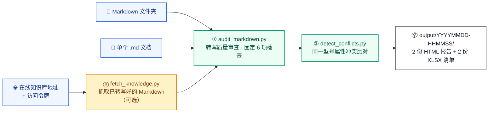

<div align="center">

# 🧭 knowledge-audit-skill

**知识库质量审查 Agent Skill**

一条命令查出两类问题：**文档转写得好不好**、**同一型号的参数是否互相矛盾** ——
每条结论都带证据定位（文件 / 行号 / 原文），并交付 **2 份 HTML 报告 + 2 份 XLSX 清单表格**。

[](https://agentskills.io)
[](https://docs.claude.com/en/docs/claude-code/skills)
[](https://developers.openai.com/codex/)
[](https://www.python.org/)
[](#快速开始)
[](LICENSE)

</div>

---

## 它解决什么问题

| 症状 | 本技能的答案 |
| --- | --- |
| 文档转成 Markdown 后有些地方看着不对：乱码、替换字符、`[OCR]`、`待补充`、空文件 | **① 转写质量审查**：6 项固定检查逐行检出，给出文件、行号与证据原文 |
| 两份手册写了同一台机器（如 `机器ABCDEF-100`）的“操作重量”，一份 12300 kg、一份 12400 kg | **② 同一型号属性冲突检测**：按「型号 + 属性名 + 工况」分组比对，列出全部来源文件与取值 |

- **每条结论可复核**：附文件、行号、证据原文，不猜也不编；
- **只报问题、不设分级**：性质判断交给人；
- **只读**：不改动输入文档，报告只写进 `output/<时间戳>/`；
- **零依赖、可移植**：只用 Python 3.9+ 标准库（XLSX 也由标准库手写），Windows / macOS / Linux 一致，中文路径开箱可用；
- **口径可追溯**：检查规则与单位换算放在 `rules/*.json`，报告写明检查项、规则来源与生成时间。

## 工作流程



## 快速开始

需要 **Python 3.9+** 与标准库；输入是**已经转写好的 Markdown**，不需要原始 DOCX / PDF / 图片。

```bash
git clone https://github.com/soft-breeze1/knowledge-audit-skill.git
cd knowledge-audit-skill

# 一条命令跑完整流程（input/ 是内置演示语料）
python scripts/run_all.py input/

# 交付在 output/<时间戳>/，打开两份 HTML 即可
```

常用变体：

```bash
python scripts/run_all.py input/ --fail-on-issue                  # 发现问题即以退出码 3 结束（CI 卡口）
python scripts/run_all.py --url "<知识库地址>" --token "<token>"    # 在线知识库：先抓取再审查
python scripts/run_all.py --url "<知识库地址>" --token "<token>" --limit 0 --all-assets --workers 16
python scripts/audit_markdown.py input/                           # 只跑①转写质量审查
python scripts/detect_conflicts.py input/                         # 只跑②属性冲突比对
```

**内置演示语料**：`input/` 里的机型与参数全部为虚构值 —— `example.md` 覆盖各类转写缺陷；`products/` 下两份 `机器ABCDEF-100` 故意留了一处冲突。预期结果见 [`input/README.md`](input/README.md)（4 个交付文件、3 处质量问题、42 条属性记录、17 组比对、1 处冲突）。

## 在线抓取（可选）

`--url` + `--token` 时先抓 Markdown 再审查，抓到的文件写入 `<输出根目录>/_kb_source/<时间戳>/`（输入缓存，不计入交付文件）。

| 参数 | 默认 | 说明 |
| --- | --- | --- |
| `--limit` | `200` | 最多抓多少篇；`0` 表示不限制 |
| `--workers` | `8` | 并发线程数（1 = 单线程，上限 32） |
| `--retries` | `3` | 单个失败请求的重试次数（指数退避）；抓取结束后还会对失败文档补抓几轮 |
| `--proxy` | `auto` | `auto` 探测直连与系统代理后选更快的；也可 `direct` / `system` / `<host:port 或 URL>` |
| `--overwrite` | 关闭 | 忽略本地已有文件强制重抓；默认断点续跑，中断后重跑同一条命令只补缺口 |
| `--all-assets` | 关闭 | 抓列表内全部资产，不做类型 / 生命周期 / 质量过滤（另有 `--any-quality` 放宽质量状态） |
| `--strict-fetch` | 关闭 | 有任何一篇漏取即中止流水线；默认漏取只提示，审查照常进行 |
| `--api-base` / `--token-header` / `--workspace` | `<站点>/api/v1` / `x-access-token` / — | 接口根地址 / 令牌请求头名 / 限定工作区 |

- 并发只用于「取版本 + 取正文」；列表分页、资产过滤与「同一文档只抓第一份」仍按列表顺序单线程判定，结果与单线程一致；断点续跑以本地文件为进度，不产生额外状态文件；
- 正文 URL 支持完整地址、站点绝对路径、已含接口前缀、相对路径四种写法；接口返回 200 但正文是 JSON / HTML 报错页时会被拒收并单独计数（`--keep-raw-content` 可关闭校验）；
- 进度条在重定向到文件或 CI 日志时自动降级为每 5% 一行。

## 交付物

每次运行在 `output/<YYYYMMDD-HHMMSS>/` 固定交付 4 个文件（一次任务一个目录，互不覆盖）：

| 交付文件 | 内容 |
| --- | --- |
| `知识库文档解析与转写质量问题报告.html` | 审查概况、6 项检查的分布、按文件分组的问题明细（行号 + 证据原文） |
| `知识库文档解析与转写质量问题报告.xlsx` | 逐行清单：文件、行号、问题类型、问题说明、证据原文、建议操作 |
| `知识库同类属性冲突审查报告.html` | 比对概况，以及每个冲突分组的来源文档、行号、原始与换算后取值、证据 |
| `知识库同类属性冲突审查报告.xlsx` | 逐行清单：冲突编号、型号、属性、工况、原始取值、换算后取值、文档、行号、证据原文 |

HTML 单文件自包含（样式内联），双击即开、可直接转发；XLSX 表头着色、列宽加宽、单元格边框、隔行斑马纹、首行冻结并开启自动筛选。

## 安装到 Agent

本技能遵循 [Agent Skills 开放标准](https://agentskills.io/specification)：一个技能就是一个目录，至少含一个 `SKILL.md`。仓库已内置两个客户端的项目级发现路径。

```bash
# Claude Code（.claude/skills/knowledge-audit/）
git clone https://github.com/soft-breeze1/knowledge-audit-skill.git && cd knowledge-audit-skill && claude
cp -r .claude/skills/knowledge-audit /path/to/your-project/.claude/skills/   # 装到别的项目
cp -r .claude/skills/knowledge-audit ~/.claude/skills/                        # 装成个人级

# Codex（.agents/skills/knowledge-audit/）
cp -r .agents/skills/knowledge-audit /path/to/your-project/.agents/skills/
```

其他客户端：把 `knowledge-audit/` 目录（`SKILL.md` + `scripts/` + `rules/`）放进客户端扫描的 skills 目录即可。用法：自然语言触发（“帮我审查这批知识库文档的转写质量”），或显式调用 `/knowledge-audit input/`。

> 根目录 `SKILL.md` 是唯一真源，`.claude/` 与 `.agents/` 下是由脚本同步的副本：改完执行 `python scripts/sync_skill.py`，校验用 `python scripts/sync_skill.py --check`（不一致时退出码 1）。

## 命令行参考

`run_all.py`（推荐入口）：

| 参数 | 默认 | 说明 |
| --- | --- | --- |
| `input` | — | 待审查的 Markdown 文件或目录（与 `--url` 二选一） |
| `--output` | `output` | 输出根目录（每次运行在其下新建时间戳子目录） |
| `--report-name` | `知识库文档解析与转写质量问题报告` | 质量审查报告基名 |
| `--rules` / `--alias-rules` | `rules/ocr_patterns.json` / `rules/attribute_aliases.json` | 规则文件 |
| `--max-file-size` | `20971520`（20 MB） | 单文件大小上限，超过则跳过内容级检查 |
| `--fail-on-issue` | 关闭 | 发现问题时以退出码 3 结束 |
| `--no-progress` | 关闭 | 关闭进度条 |

在线抓取相关参数（`--url`、`--token`、`--api-base`、`--limit`、`--workers`、`--retries`、`--proxy`、`--all-assets`、`--overwrite`、`--strict-fetch`、`--kb-output` 等）见上方「在线抓取（可选）」。

单阶段脚本：

| 脚本 | 参数 |
| --- | --- |
| `audit_markdown.py` | `input`、`--output`、`--report-name`、`--rules`、`--max-file-size`、`--fail-on-issue`、`--no-progress` |
| `detect_conflicts.py` | `input`、`--output`、`--alias-rules`、`--no-progress` |
| `fetch_knowledge.py` | `url`、`--api-base`、`--token`、`--token-header`、`--limit`、`--workspace`、`--any-quality`、`--all-assets`、`--max-file-size`、`--timeout`、`--output`、`--workers`、`--retries`、`--proxy`、`--overwrite`、`--keep-raw-content`、`--no-progress` |
| `sync_skill.py` | `--check`（仅校验 `SKILL.md` 副本一致性） |
| `check_deliverables.py` | `--output`、`--expect-html`、`--expect-xlsx`（校验运行目录里是 2 HTML + 2 XLSX，CI 与本地自检共用） |

### 退出码

| 退出码 | 含义 |
| --- | --- |
| `0` | 流程完成 |
| `1` | 输入 / 输出错误（含网络与接口调用失败） |
| `2` | 参数或规则文件错误 |
| `3` | 完成但发现问题（仅 `--fail-on-issue`） |

## 检查口径与比对口径

### 第一阶段：转写质量审查（固定 6 项）

| 检查项 | 说明 |
| --- | --- |
| 编码可解码性（UTF-8） | 文件能否按 UTF-8 解码；解码失败的字节就是损坏处 |
| 替换字符 U+FFFD | 解码失败留下的占位字符，原内容已丢失 |
| 编码乱码特征 | 编码转换后出现的典型乱码字样（规则见 `rules/ocr_patterns.json`） |
| OCR 标记残留 | 方括号 OCR / 图片 / 表格一类残留标记（同上规则文件） |
| 占位符文本 | 未补全的待办类标记与“待补充”一类表述（同上规则文件） |
| 空文件检测 | 0 字节文件，可能是转写失败或占位文件 |

- 6 项检查的问题**全部**计入「存在问题文件数 / 问题总数」，并逐行写入清单表格（分类即检查项，不设分级）；
- 表格结构、空章节、代码块未闭合、疑似截断、图片引用、标题层级、零宽字符等**结构性写法不作上报**；
- 代码块内只检查替换字符与编码乱码特征，避免把示例代码误报为占位符 / OCR 标记；
- 读取失败或超过大小上限的文件属“漏审风险”，不计入统计；数量与文件名在控制台提示，并写入 HTML 报告「附：本次运行信息」（便于人工补审）。

### 第二阶段：同一型号属性冲突检测

- 分组键为「型号 + 标准属性名 + 工况」三者**完全一致**：型号按原文精确匹配并保留变型词（`ABCDEF-100 HEV` 与 `ABCDEF-100` 不是同一台机器）；额定 / 最大 / 最小 / 尾部括注等工况限定词单独记录，不参与别名合并；
- 列为冲突需同时满足：取值不一致，且证据来自 **≥2 个不同文件**（同一文件内重复只算单一来源）；
- 取值比较：① 各方单位都已收录且量纲相同 → 按换算后的标准值比较；② 单位字面相同但未收录 → 按数值字面比较；③ 其余 → 按原始取值字面比较；
- 抽取为规则式（非语义理解）：只识别可客观定位的形态（两列表、“属性-取值-单位”列组表、正文 `属性：数值+单位`）；标识类字段（物料编码 / 零件号 / 图号 / 序号）、故障排查表、备件清单、版本履历表、复合取值（范围、多维尺寸）不抽取；未识别型号或只有单一来源的记录不参与比对（只给数量）。

## 输出目录

```text
output/
├── 20261026-135023/                     # 本次运行的时间戳子目录（YYYYMMDD-HHMMSS）
│   ├── 知识库文档解析与转写质量问题报告.html / .xlsx
│   └── 知识库同类属性冲突审查报告.html / .xlsx
└── _kb_source/
    └── 20261026-124001/                 # 在线抓取的 Markdown（输入缓存，不计入交付文件）
```

- 一次任务一个目录，多次运行互不覆盖；用 `--output` 指定时直接写入该目录；
- 扫描输入时自动排除：输出目录、本工具生成的报告文件、隐藏目录、`__pycache__` / `node_modules` / `venv`；
- 只交付 HTML 与 XLSX 两类文件，全流程**不生成 Markdown / JSON 文件**（`rules/*.json` 是配置输入，由你维护）；
- 运行开始时会打印输入路径（绝对路径）、交付目录与匹配到的 Markdown 文件数，报告文末「本次运行信息」同样给出输入路径。

## 规则配置

两份规则都是普通 JSON，改完即生效（文件缺失或无法解析时回退内置精简规则）：

```json
// rules/ocr_patterns.json —— pattern 为 Python re 正则，flags 可选 IGNORECASE / MULTILINE
{ "rules": {
  "ocr_markers": [ { "id": "ocr-bracket-en", "pattern": "(?<!!)\\[\\s*OCR\\s*\\](?!\\()",
                     "flags": ["IGNORECASE"], "description": "方括号 OCR 标记残留（如 [OCR]）",
                     "suggested_action": "对照原始文档替换为真实内容，或删除该标记。" } ],
  "placeholders": [ { "id": "wait-supplement", "pattern": "待补充" } ],
  "mojibake":     [ { "id": "gbk-mojibake", "pattern": "锟斤拷|烫烫烫" } ]
} }
```

```json
// rules/attribute_aliases.json —— 标准属性名 → 同义词；单位写法 → 标准符号与换算因子
{ "attribute_aliases": { "重量": ["整机重量", "操作重量", "weight"] },
  "unit_symbols": { "吨": "t", "千瓦": "kW", "转/分": "r/min" },
  "units": { "mass": { "canonical": "kg", "factors": { "kg": 1.0, "t": 1000.0 } } } }
```

- 类别与检查项对应：`ocr_markers` → OCR 标记残留、`placeholders` → 占位符文本、`mojibake` → 编码乱码特征；
- 别名只合并真实同义词（额定 / 最大 / 最小等工况限定词不合并）；未收录的单位只记录原文，不猜量纲；
- 用 `--rules` / `--alias-rules` 指定自定义规则文件，**显式指定但不可用时退出码 2**。

## 在 CI 中使用

`--fail-on-issue` 把“发现问题”变成可卡口的构建失败。仓库内置一份开箱可用的 workflow（[`.github/workflows/knowledge-audit.yml`](.github/workflows/knowledge-audit.yml)）：在 Ubuntu / Windows × Python 3.9 / 3.12 上跑内置演示语料，校验 `SKILL.md` 副本一致性与交付文件数量（由 `scripts/check_deliverables.py` 校验，跨平台一致，不符时在 Actions 页面发出 `::error::` 注解），并上传报告作为构建产物。

```yaml
- uses: actions/setup-python@v5
  with: { python-version: "3.11" }
- run: python scripts/sync_skill.py --check
- run: python scripts/run_all.py input/ --fail-on-issue
- run: python scripts/check_deliverables.py
- uses: actions/upload-artifact@v4
  if: always()
  with: { name: knowledge-audit-reports, path: output/*/ }
```

只想产出报告、不想让流水线失败：去掉 `--fail-on-issue`，或给该步骤加 `continue-on-error: true`。在线模式需把令牌（如 `KB_ACCESS_TOKEN`）配成仓库 Secret。

## 常见问题

<details><summary><b>会修改我的文档吗？需要装依赖吗？能直接审 DOCX / PDF / 图片吗？</b></summary>

不会改，也不需要装依赖：输入全程只读，只用 Python 3.9+ 标准库（XLSX 的 Open XML 也由标准库手写），报告只写进 `output/` 下的时间戳子目录。但不能审 DOCX / PDF / 图片 —— 本技能只审查**已经转写好的 Markdown 文本**，不解析原始文件，也不承诺“转写内容与原始文档逐字一致”。
</details>

<details><summary><b>为什么很多“看着像问题”的写法没被报出来？</b></summary>

检查口径固定为 6 项（见上方口径表），表格结构、空章节、代码块未闭合、疑似截断等结构性写法不在口径内，以免成百上千条留白把真正的风险点淹没。
</details>

<details><summary><b>同一份文档里重复出现的参数会被当作冲突吗？</b></summary>

不会。冲突要求证据来自 **≥2 个不同文件**；同一文件内重复只算单一来源，数量在报告的「比对概况」中给出。
</details>

<details><summary><b>我明明看到两处不一致，报告里却没有？</b></summary>

按顺序自查：① 型号是否与原文完全一致；② 属性名是否归一化到同一标准名（见 `rules/attribute_aliases.json`）；③ 工况限定词是否一致（额定 / 最大 / 最小 / 尾部括注算不同工况）；④ 证据是否来自 ≥2 个不同文件；⑤ 报告「比对概况」里的「未参与比对的记录」是否很多。仍不确定时，用两个 `.md` 组成最小复现语料单独跑一次最容易定位。
</details>

## 版本更迭

| 版本 | 解决了什么 |
| --- | --- |
| `1.0.4` | 清理冗余代码，修复进度条与漏审风险展示，精简 SKILL 描述 |
| `1.0.3` | 精简 README 篇幅，补充版本更迭记录 |
| `1.0.2` | 修复 Windows 上 CI 交付文件校验失败（改用 `scripts/check_deliverables.py`） |
| `1.0.1` | 在线抓取支持并发、断点续跑、失败重试与连接自适应；审查增加进度条、统计自检与可配置的失败门控 |
| `1.0.0` | 初始版本：转写质量审查（固定 6 项）+ 同一型号属性冲突检测 |

> 版本号在 `scripts/generate_report.py` 的 `TOOL_VERSION`，会出现在报告页脚与「本次运行信息」中。改口径后建议：跑一遍 `input/` 核对预期结果 → `python scripts/sync_skill.py` → 提交。

## 许可证

以 **MIT** 许可证发布，见 [LICENSE](LICENSE)：可自由用于商业与个人项目，保留版权声明即可。

---

<div align="center">

**如果这个技能帮你省下人工核对表格的时间，欢迎点个 ⭐ Star。**

问题与建议请开 [Issue](https://github.com/soft-breeze1/knowledge-audit-skill/issues)；改进请提 PR。

</div>
